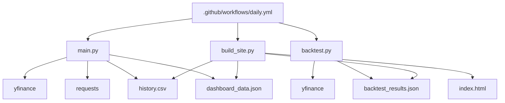

# 01-架构总览

## 1. 架构风格

本项目采用的是轻量脚本式架构，而不是传统的“控制器/服务/仓储”分层。它的核心特点如下：

- 以 `main.py` 为中心脚本，直接串联采集、分析、落盘与通知。
- 以 `backtest.py` 作为离线研究脚本，独立输出胜率统计。
- 以 `build_site.py` 作为静态页面构建脚本，消费 CSV/JSON 数据。
- 以 GitHub Actions 作为统一调度层，驱动整套流程按时间运行。

这种架构的优点是实现直接、部署简单、维护成本低；缺点是逻辑聚合在单文件中较多，后续如果功能持续扩展，`main.py` 会逐步承担过多职责。

## 2. 分层视角

虽然代码未显式分层，但可以从职责上抽象为 5 层：

### 2.1 数据采集层

- `yfinance`：获取期货、ETF、指数的历史 K 线与实时分钟数据。
- `requests` + FMP API：获取经济日历。
- `requests` + Telegram/Gmail/CallMeBot：发送外部通知。

### 2.2 指标计算层

- `calculate_custom_indicators()`
  - 计算 EMA50、EMA700、EMA800、EMA900、EMA1000、EMA3500。
  - 计算 MACD 使用的 `DIF`。
  - 计算 KDJ 使用的 `J` 值。
- `calculate_macd()`、`calculate_kdj()`
  - 在 `backtest.py` 中复用相同思路进行离线回测。

### 2.3 信号识别层

- 旧逻辑：`scipy_pivots()` + `check_pivot_divergence()`
  - 面向周/月大周期的已确认 Pivot 背离识别。
- 新逻辑：`check_dual_lookback()` + `scan_dual_lookback()`
  - 面向月/周/日/4H 的双回看窗口背离识别。
  - 支持长短 Lookback、双顶/双底/新高/新低等形态判定。

### 2.4 输出编排层

- `save_history()`
  - 生成当日结构化信号记录并写入 `history.csv`
  - 生成 Dashboard 快照并写入 `dashboard_data.json`
- `build_email_body()`
  - 把宏观背景、共振结果、即时信号、关键位和日历组装为文本消息。
- `send_telegram()`
  - 发送 Telegram 消息。
- SMTP 逻辑
  - 发送 HTML 形式的邮件。

### 2.5 展示与调度层

- `build_site.py`
  - 从 `history.csv`、`dashboard_data.json`、`backtest_results.json` 构造页面。
- `.github/workflows/daily.yml`
  - 负责日常全量扫描、晚间 Dashboard 更新、双月回测与产物提交。

## 3. 核心运行路径

### 3.1 06:00 全量模式

`main.py` 在 HKT 06:00 进入 Full 模式，执行以下步骤：

1. 遍历 `ALL_TARGETS` 中的全部标的。
2. 对周/月执行 Pivot 扫描。
3. 对月/周执行 Dual Lookback 扫描，形成 `dual_mw`。
4. 对日/4H 执行 Dual Lookback 扫描，形成 `dual_dh`。
5. 将结果写入 `history.csv` 和 `dashboard_data.json`。
6. 生成邮件正文并发送 Email。
7. 截断邮件正文前 4000 字发送 Telegram。

### 3.2 21:00 Dashboard Only 模式

`main.py` 在 HKT 21:00 进入 Dashboard Only 模式，只刷新 Dashboard 依赖的快照数据：

1. 读取现有 `history.csv`
2. 重新计算 `nq_key_levels`
3. 重新计算 `nq_ema`
4. 重新抓取 `fmp_calendar`
5. 写入 `dashboard_data.json`
6. 结束，不发送邮件，不扫描全量标的

### 3.3 双月回测模式

GitHub Actions 在奇数月追加执行 `backtest.py`：

1. 下载各标的各周期历史数据
2. 回放 Dual Lookback 信号
3. 统计顶/底背离在 T+1/T+3/T+5 的胜率和平均涨跌
4. 输出 `backtest_results.json`

### 3.4 静态页面构建

`build_site.py` 每次工作流都会运行：

1. 读取 `history.csv`
2. 读取 `dashboard_data.json`
3. 读取 `backtest_results.json`
4. 计算趋势、强度分布、共振、Top 标的、关键位等摘要
5. 直接拼接 HTML
6. 输出 `index.html`

## 4. 模块依赖关系

## 5. 数据流说明

### 5.1 输入数据

- 市场行情
  - 来自 `yfinance` 的历史和实时数据。
- 经济日历
  - 来自 FMP API。
- 环境配置
  - 来自 GitHub Secrets 或本地环境变量。

### 5.2 中间数据

- `pivot_sigs`
  - Pivot 旧逻辑生成的已确认背离信号。
- `dual_mw`
  - 月/周 Dual Lookback 信号。
- `dual_dh`
  - 日/4H Dual Lookback 信号。

### 5.3 输出数据

- `history.csv`
  - 面向历史追踪和 Dashboard 表格。
- `dashboard_data.json`
  - 面向实时摘要卡片。
- `backtest_results.json`
  - 面向回测统计展示。
- `index.html`
  - 面向最终浏览器查看。

## 6. 设计重点

### 6.1 为什么同时保留两套背离逻辑

- Pivot 逻辑更偏“已确认结构”，适合周/月大趋势判断。
- Dual Lookback 逻辑更偏“近端对比”，适合日内到中周期监控。
- 两者并存，使邮件内容同时具有“背景判断”和“即时交易提示”。

### 6.2 为什么回测结果内置到主流程

- `main.py` 中维护了 `WIN_RATE` 映射。
- 这样每次生成信号时可以直接为结果打上历史胜率标签。
- 代价是回测结果与主程序之间存在人工同步关系，不是实时自动注入。

### 6.3 为什么 Dashboard 由 Python 直接生成 HTML

- 避免引入前端工程链路。
- GitHub Pages 或静态托管更容易发布。
- 代价是 HTML/CSS/JS 均集中在单个 Python 函数中，可维护性一般。

## 7. 架构风险与改进方向

- `main.py` 体量较大，建议未来拆分为：
  - `data_sources.py`
  - `indicators.py`
  - `signal_engines.py`
  - `reporting.py`
  - `storage.py`
- `WIN_RATE` 目前硬编码在源码中，建议改为从 `backtest_results.json` 动态读取。
- `build_site.py` 以字符串拼接 HTML，建议提取模板或使用轻量模板引擎。
- `radar.py` 与 `turnover.py` 仍是独立旁路脚本，建议明确其是否仍属于主产品能力。
