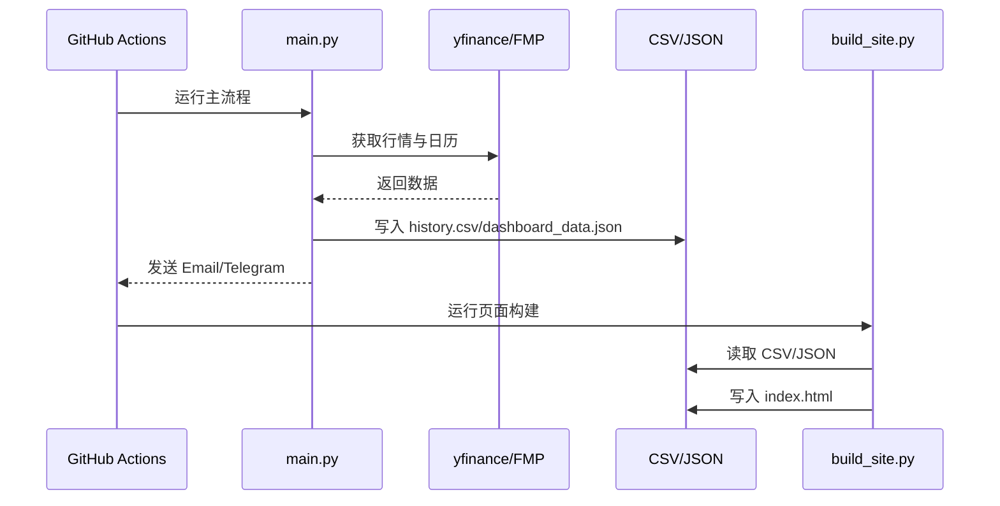

# 02-模块详解

## 1. `main.py`

### 1.1 模块定位

`main.py` 是项目的主业务入口，承担以下职责：

- 定义监控标的、分类和权重
- 计算技术指标
- 执行两套背离识别逻辑
- 组织多周期信号
- 写入历史数据与 Dashboard 快照
- 生成邮件正文
- 发送 Email 与 Telegram

### 1.2 核心配置

- `EMAIL_CONFIG`
  - Gmail SMTP 配置，读取 `EMAIL_USER`、`EMAIL_PASS`、`EMAIL_TO`。
- `TELEGRAM_TOKEN`、`TELEGRAM_CHAT_ID`
  - Telegram 发送配置。
- `FMP_API_KEY`
  - 财经日历 API Key。
- `ALL_TARGETS`
  - 主监控池，定义中文名、表情、权重、分类。
- `WIN_RATE`
  - 历史回测胜率映射，用于给信号附加星级标签。
- `PIVOT_CONFIG`
  - 周/月 Pivot 扫描参数。
- `DUAL_LB_CONFIG`
  - 各周期双 Lookback 扫描参数。
- `INTERVAL_MAP`
  - 周期到 `yfinance` 下载参数的映射。

### 1.3 内部子能力

#### A. 工具函数

- `get_win_rate()`
  - 从 `WIN_RATE` 查历史胜率。
- `get_win_tag()`
  - 把胜率转换为星级展示。
- `time_ago()`
  - 把背离距离转换成“几日前/几周前/几个月前”。
- `is_dashboard_only()`
  - 依据 HKT 当前小时判断是否处于 21:00 Dashboard 模式。
- `get_strength()`
  - 根据指标变化幅度给信号打上“强/中/弱”。

#### B. 指标计算

- `calculate_custom_indicators()`
  - 核心指标工厂函数。
  - 输出 `Close`、`High`、`Low`、`DIF`、`J` 和多条 EMA。

#### C. 背离识别

- `scipy_pivots()`
  - 基于 `scipy.signal.find_peaks` 找局部高低点。
- `check_pivot_divergence()`
  - 比较价格与指标的高点/低点，生成“顶/底背离”。
- `check_dual_lookback()`
  - 在长短窗口内比较“当前价/指标”与“历史高低点/指标”，识别双顶、双底、新高顶背离、新低底背离。
- `scan_pivot()`
  - 包装 Pivot 逻辑，用于指定标的和周期的扫描。
- `scan_dual_lookback()`
  - 包装 Dual Lookback 逻辑，并对日/4H 数据尝试用实时 1 分钟价格修正最后一根 K 线。

#### D. 宏观扩展数据

- `get_fmp_calendar()`
  - 抓取高影响财经日历并附带风控提示。
- `get_overnight_and_key_levels()`
  - 汇总 NQ、ES、YM、VIX、黄金、原油、美指、美债隔夜表现，并计算 NQ 的 Pivot/R1/S1。
- `get_nq_custom_chart_status()`
  - 评估 NQ 5 分钟级别 EMA700-1000 带和 EMA3500 的状态。
- `get_nq_key_levels_data()`
  - 为 Dashboard 生成 NQ 关键位数据。
- `get_nq_ema_data()`
  - 为 Dashboard 生成 NQ EMA 带数据。

#### E. 格式化与聚合

- `fmt_pivot_signal()`
  - 把 Pivot 信号格式化成邮件文本。
- `fmt_dual_signal_body()`
  - 把 Dual Lookback 信号格式化成邮件文本。
- `group_dual_by_ticker()`
  - 将日/4H 信号按标的聚合，形成“每个标的一块”的输出结构。
- `build_macro_section()`
  - 汇总周/月大周期结构和 Dual Lookback 背景。
- `get_resonance()`
  - 识别同一标的在多个周期出现相同方向信号的“多周期共振”。

#### F. 输出与发送

- `save_history()`
  - 生成当日标准化记录，写入 `history.csv`。
  - 同时生成 `dashboard_data.json`。
- `send_telegram()`
  - 通过 Telegram Bot API 发送消息。
- `build_email_body()`
  - 生成完整晨报文本。
- `main()`
  - 主控制流入口。

### 1.4 输入与输出

- 输入
  - 环境变量
  - `yfinance` 行情
  - FMP 财经日历
- 输出
  - `history.csv`
  - `dashboard_data.json`
  - Email
  - Telegram

## 2. `backtest.py`

### 2.1 模块定位

`backtest.py` 负责将主策略中的 Dual Lookback 逻辑放到历史数据上回放，统计策略效果，形成可读的历史成功率数据。

### 2.2 主要职责

- 下载 15 个标的在 M/W/D/4H 四个周期的数据
- 重建 MACD 与 KDJ 指标
- 使用 `check_dual_lookback()` 识别历史信号
- 统计 T+1/T+3/T+5 成功率与平均涨跌
- 输出 `backtest_results.json`

### 2.3 关键特点

- 只回测新逻辑 Dual Lookback，不回测 Pivot 旧逻辑。
- 对 `4H` 周期，先取 `1h` 数据，再重采样成 `4h`。
- 回测结果按 `ticker -> level -> direction -> horizon` 分层存储。

### 2.4 与主流程的关系

- 主流程并不直接 import `backtest.py`。
- 两者通过数据文件和人工同步的 `WIN_RATE` 建立联系。
- `build_site.py` 会直接消费 `backtest_results.json`。

## 3. `build_site.py`

### 3.1 模块定位

`build_site.py` 是纯静态 Dashboard 生成器，用 Python 直接拼接 HTML/CSS/JS，输出 `index.html`。

### 3.2 主要职责

- 读取 `history.csv` 并计算：
  - 今日信号
  - 昨日对比
  - 近 30 日趋势
  - 今日强度分布
  - Top 5 标的
  - 多周期共振
- 读取 `dashboard_data.json` 并展示：
  - 财经日历
  - NQ EMA 带
  - NQ 关键位
- 读取 `backtest_results.json` 并展示：
  - T+5 胜率表
- 提供前端交互：
  - 主题切换
  - 表格筛选
  - 搜索
  - 排序
  - CSV 导出
  - 行点击详情弹窗

### 3.3 模块设计特征

- 单函数 `build_html()` 承担全部页面构建职责。
- 数据处理、HTML 模板、CSS 样式和前端 JS 均位于同一文件。
- 适合快速迭代，但维护时应特别注意局部修改的连锁影响。

## 4. `radar.py`

### 4.1 模块定位

`radar.py` 是旧版行业 ETF 雷达脚本，独立于 `main.py` 的新主流程。

### 4.2 主要职责

- 批量下载行业 ETF 数据
- 统计日涨跌
- 检测放量
- 检测日线/周线 MACD DIF 背离
- 检测月线 KDJ J 背离
- 汇总成一条 WhatsApp 消息发送
- 附带更新简化版 `history.csv`

### 4.3 现状判断

- 它更像旧阶段原型，而不是当前主架构的一部分。
- 与 `main.py` 的数据结构和产物语义已经不完全一致。
- 若继续保留，建议在文档和命名上明确其“legacy”角色。

## 5. `turnover.py`

### 5.1 模块定位

`turnover.py` 是一个单用途告警脚本，用于筛选高换手 ETF 并通过 WhatsApp 推送。

### 5.2 主要职责

- 遍历固定 ETF 列表
- 读取最新成交量
- 尝试读取流通股或总股本
- 估算换手率
- 当换手率大于 5% 时触发告警

### 5.3 设计特征

- 没有函数封装，整个文件就是执行逻辑。
- 偏运维脚本风格，复用性较低。

## 6. `.github/workflows/daily.yml`

### 6.1 模块定位

该文件是整个项目的生产调度入口。

### 6.2 主要职责

- 每天 UTC 22:00 触发一次，对应 HKT 06:00
- 每天 UTC 13:00 触发一次，对应 HKT 21:00
- 安装 Python 3.11 与依赖
- 运行 `main.py`
- 在奇数月运行 `backtest.py`
- 运行 `build_site.py`
- 将更新后的产物提交回仓库

### 6.3 影响范围

该工作流决定了：

- 项目何时运行
- 哪些环境变量必须存在
- 哪些产物会被持续覆盖
- 页面与数据的刷新节奏

## 7. 模块协作总结

