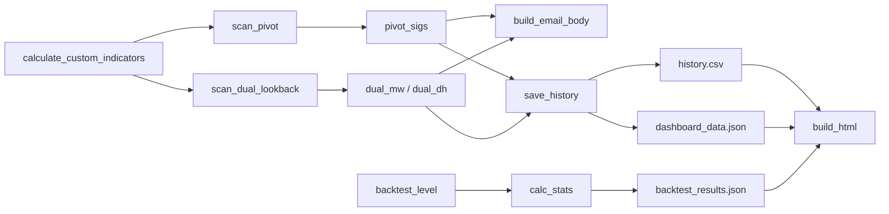

# 03-关键函数与符号

## 1. 说明

本项目是以函数式脚本为主的仓库，核心知识点不在“类”，而在以下三类符号：

- 配置常量
- 关键函数
- 主入口函数

因此本页重点说明这些高价值符号的职责、输入输出和在系统中的位置。

## 2. `main.py` 关键符号

### 2.1 配置常量

| 符号 | 作用 | 备注 |
| --- | --- | --- |
| `ALL_TARGETS` | 定义监控标的池 | 含中文名、分类、权重、图标 |
| `WIN_RATE` | 历史胜率映射 | 用于邮件和历史记录展示 |
| `PIVOT_CONFIG` | 周/月 Pivot 扫描配置 | 控制 prominence、distance、recent_window |
| `DUAL_LB_CONFIG` | Dual Lookback 参数 | 按周期配置长短窗口和阈值 |
| `INTERVAL_MAP` | 行情下载映射 | 周期到 `period`/`interval` 的桥梁 |

### 2.2 核心函数表

| 函数 | 作用 | 输入 | 输出 |
| --- | --- | --- | --- |
| `calculate_custom_indicators(df)` | 统一计算 EMA / DIF / J | OHLC DataFrame | 指标 DataFrame |
| `scipy_pivots(series, prominence_pct, distance)` | 寻找价格高低点 | 价格序列 | 高点索引、低点索引 |
| `check_pivot_divergence(...)` | 检测 Pivot 背离 | 价格序列、指标序列、高低点 | `('頂', dist)` / `('底', dist)` / `None` |
| `check_dual_lookback(...)` | 检测长短窗口背离 | 价格序列、指标序列、阈值 | `{'long': [], 'short': []}` |
| `get_raw_df(t, lv)` | 下载并预处理行情 | 标的、周期 | 标准化 OHLCV DataFrame |
| `scan_pivot(t, info, lv, params)` | 扫描旧逻辑背离 | 标的、周期、参数 | Pivot 信号列表 |
| `scan_dual_lookback(t, info, lv)` | 扫描新逻辑背离 | 标的、周期 | Dual Lookback 信号列表 |
| `get_fmp_calendar()` | 拉取财经日历 | 无 | 日历文本 |
| `get_overnight_and_key_levels()` | 生成隔夜摘要与关键位 | 无 | 两段文本 |
| `get_nq_key_levels_data()` | 生成 Dashboard 的关键位结构化数据 | 无 | dict |
| `get_nq_ema_data()` | 生成 Dashboard 的 EMA 快照 | 无 | dict / `None` |
| `group_dual_by_ticker(signals)` | 按标的聚合即时信号 | 信号列表 | 每个标的一段文本块 |
| `build_macro_section(...)` | 汇总周/月背景 | 大周期信号 | 文本行列表 |
| `get_resonance(...)` | 识别多周期共振 | 多周期信号 | 共振列表 |
| `save_history(...)` | 写入历史与 Dashboard 快照 | 三类信号列表 | 文件副作用 |
| `send_telegram(text)` | 发送 Telegram | 文本 | 无 |
| `build_email_body(...)` | 生成晨报正文 | 三类信号列表 | 文本 |
| `main()` | 总控制流 | 环境与外部数据 | 任务执行副作用 |

### 2.3 重点函数解析

#### `calculate_custom_indicators(df)`

职责：

- 对给定 K 线数据一次性计算主流程需要的全部技术指标。
- 降低后续扫描逻辑中重复计算成本。

输出字段：

- `Close`, `High`, `Low`
- `DIF`
- `J`
- `EMA50`, `EMA700`, `EMA800`, `EMA900`, `EMA1000`, `EMA3500`

为什么关键：

- 它是所有信号识别的共同上游。
- 只要指标定义发生变化，主扫描、关键位、EMA 监测都会受影响。

#### `check_dual_lookback(price, indicator, short_lb, long_lb, price_tol, ind_drop_min)`

职责：

- 比较“当前价格/指标”与近一段窗口内的历史极值及其指标值。
- 判定是否构成顶背离或底背离。

核心规则：

- 顶背离
  - 当前价格接近或超过前高
  - 指标相对前高显著下降
- 底背离
  - 当前价格接近或跌破前低
  - 指标相对前低显著上升

输出结构：

- `long`
  - 长窗口信号列表
- `short`
  - 短窗口信号列表

每个信号携带：

- `type`
- `tag`
- `current_price`
- `prev_price`
- `current_ind`
- `prev_ind`
- `dist`
- `price_diff_pct`
- `ind_change_pct`

为什么关键：

- 它是当前主策略最核心的判定函数。
- `main.py` 和 `backtest.py` 都依赖它或其同构逻辑。

#### `scan_dual_lookback(t, info, lv)`

职责：

- 为单个标的、单个周期执行完整的 Dual Lookback 扫描。

关键细节：

- 对 `M`、`W` 周期会丢弃最后一根未确认 K 线。
- 对 `D`、`4H` 周期会尝试拉 1 分钟实时价格修正最后一根 K 线。
- 同时对 `DIF` 和 `J` 两个指标做检测。

为什么关键：

- 它把“原子判定函数”升级成“可用于生产流程的扫描器”。
- 也是主流程里调用次数最多的业务函数之一。

#### `save_history(pivot_sigs, dual_mw, dual_dh)`

职责：

- 将离散信号归并成标准化的记录行。
- 把当日信号持久化，供 Dashboard 和后续历史分析使用。

核心行为：

- 优先保留长窗口信号，没有长窗口则退回短窗口。
- 将 DIF 和 J 的存在情况折叠成同一行。
- 把“双指标共振”提升强度等级。
- 为记录附加历史胜率字段。
- 覆盖当天历史数据，避免重复写入。
- 顺带更新 `dashboard_data.json`。

为什么关键：

- 它定义了整个项目最重要的数据契约：`history.csv` 的列结构和语义。

#### `build_email_body(pivot_sigs, dual_dh, dual_mw)`

职责：

- 把多种信息源整合成一份人可读的晨报/晚报。

内容组成：

- 大势背景
- 月/周结构
- 多周期共振
- 日/4H 即时信号
- 隔夜与宏观数据
- NQ 关键位
- EMA 带监测
- 财经日历

为什么关键：

- 它是最终面向用户的信息呈现层。
- 上游任何数据结构变化都会反映到这里。

## 3. `backtest.py` 关键符号

### 3.1 关键常量

| 符号 | 作用 |
| --- | --- |
| `TICKERS` | 回测标的池 |
| `LEVELS` | 回测周期列表 |
| `INTERVAL_MAP` | 下载参数映射 |
| `DUAL_LB_CONFIG` | 各周期 Dual Lookback 参数 |

### 3.2 关键函数

| 函数 | 作用 | 备注 |
| --- | --- | --- |
| `calculate_macd(close)` | 计算 DIF/DEA/HIST | 回测版 MACD |
| `calculate_kdj(df)` | 计算 J 值 | 回测版 KDJ |
| `check_dual_lookback(...)` | 判定历史背离 | 与主流程思想一致 |
| `backtest_level(df, lv)` | 在单周期序列上回放信号 | 返回历史信号列表 |
| `calc_stats(signals, df, direction, t_days)` | 统计某方向在指定 horizon 的表现 | 输出 count/winRate/avgChange |
| `main()` | 回测总入口 | 输出 `backtest_results.json` |

### 3.3 关键函数解析

#### `backtest_level(df, lv)`

职责：

- 在历史序列上逐点向前推进，模拟“当时只能看到历史数据”的实时扫描过程。

为什么重要：

- 这保证了回测是“近似逐日在线回放”，而不是事后整体拟合。

#### `calc_stats(signals, df, direction, t_days)`

职责：

- 评估某类信号在未来 T+N 的方向性是否成立。

判定规则：

- 对“顶”信号，未来价格下跌视为成功。
- 对“底”信号，未来价格上涨视为成功。

## 4. `build_site.py` 关键符号

### 4.1 单一核心函数

| 函数 | 作用 |
| --- | --- |
| `build_html()` | 读取数据、计算摘要、拼接页面、输出 `index.html` |

### 4.2 内部关键局部结构

虽然 `build_site.py` 只有一个主函数，但内部存在几个隐含的重要结构：

- `DISPLAY_COLS`
  - 定义今日信号表格展示列。
- `HEADER_LABELS`
  - 定义表头映射。
- `df_to_rows(d)`
  - 将 DataFrame 记录转成 HTML 表格行，并嵌入前端弹窗需要的 JSON 数据。
- `trend_data_json`
  - 近 30 日趋势图的数据源。
- `strength_data_json`
  - 今日强度环图的数据源。

### 4.3 为什么 `df_to_rows()` 值得单独关注

- 它实际上定义了 `history.csv` 如何映射到前端表格。
- 还负责强度条、共振标签、胜率样式和详情弹窗数据封装。
- 若表格列结构调整，这里通常是第一修改点。

## 5. `radar.py` 与 `turnover.py` 关键符号

### 5.1 `radar.py`

| 符号 | 作用 |
| --- | --- |
| `SECTOR_CN` | 行业 ETF 中文名映射 |
| `send(msg)` | 发送 WhatsApp 消息 |
| `macd_dif(c)` | 计算 DIF |
| `kdj_j(d)` | 计算 J |
| `div(close, ind, look)` | 简化版背离判定 |
| `get_df(batch, etf)` | 从批量下载数据中提取单 ETF 数据 |

### 5.2 `turnover.py`

该文件没有显式函数，关键符号只有：

| 符号 | 作用 |
| --- | --- |
| `ETFS` | 要扫描的 ETF 列表 |
| `turnover` | 当日估算换手率 |
| CallMeBot URL | WhatsApp 告警发送接口 |

## 6. 符号关系总结

