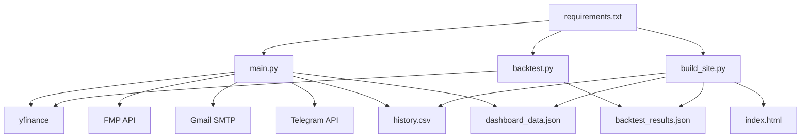

# 04-数据文件与依赖

## 1. Python 依赖

项目在 `requirements.txt` 中声明了以下基础依赖：

| 依赖 | 用途 |
| --- | --- |
| `yfinance` | 市场行情抓取 |
| `pandas` | 表格数据处理、聚合、CSV 读写 |
| `numpy` | 数值计算、极值定位 |
| `scipy` | `find_peaks` 用于 Pivot 高低点识别 |
| `requests` | HTTP 请求，包括 FMP、Telegram、CallMeBot |

## 2. 标准库依赖

项目还大量依赖 Python 标准库：

| 模块 | 用途 |
| --- | --- |
| `os` | 环境变量、文件判断 |
| `json` | 读写 Dashboard 与回测结果 |
| `csv` | CSV 相关处理 |
| `smtplib` | SMTP 发信 |
| `traceback` | 异常打印 |
| `datetime` | HKT 时间判断、日期计算 |
| `email.mime.*` | 组装 HTML 邮件 |
| `urllib.parse` | WhatsApp 文本 URL 编码 |

## 3. 外部服务依赖

### 3.1 市场数据

- `yfinance`
  - 主数据源。
  - 用于下载：
    - `NQ=F`、`ES=F`、`YM=F`
    - 行业 ETF，如 `SMH`、`XLF`、`XLE`
    - 宏观指标，如 `^VIX`、`^TNX`、`DX-Y.NYB`

风险：

- 网络稳定性影响任务成功率。
- 数据频率、时区和最新 K 线确认状态需要额外处理。

### 3.2 Financial Modeling Prep

- 用途
  - 抓取当日经济日历。
- 接口
  - `https://financialmodelingprep.com/api/v3/economic_calendar`
- 依赖变量
  - `FMP_API_KEY`

### 3.3 Gmail SMTP

- 用途
  - 发送 HTML 格式的晨报邮件。
- 关键配置
  - `EMAIL_USER`
  - `EMAIL_PASS`
  - `EMAIL_TO`

### 3.4 Telegram Bot API

- 用途
  - 发送简化版即时文本通知。
- 关键配置
  - `TELEGRAM_BOT_TOKEN`
  - `TELEGRAM_CHAT_ID`

### 3.5 CallMeBot WhatsApp

- 用途
  - `radar.py` 与 `turnover.py` 的 WhatsApp 告警。
- 关键配置
  - `CALLMEBOT_APIKEY`

## 4. 环境变量清单

| 变量名 | 用途 | 主要使用位置 |
| --- | --- | --- |
| `EMAIL_USER` | SMTP 发件账号 | `main.py` |
| `EMAIL_PASS` | SMTP 密码 | `main.py` |
| `EMAIL_TO` | 收件人地址 | `main.py` |
| `TELEGRAM_BOT_TOKEN` | Telegram Bot Token | `main.py` |
| `TELEGRAM_CHAT_ID` | Telegram 聊天 ID | `main.py` |
| `FMP_API_KEY` | FMP 财经日历 Key | `main.py` |
| `CALLMEBOT_APIKEY` | WhatsApp 告警 Key | `radar.py`、`turnover.py` |

## 5. 数据文件契约

### 5.1 `history.csv`

用途：

- 记录每天筛选出的标准化信号。
- 提供 Dashboard 的今日表格、趋势、强度和共振分析数据。

主要字段：

| 字段 | 含义 |
| --- | --- |
| `日期` | 信号日期 |
| `標的` | 标的代码 |
| `中文名` | 标的中文名 |
| `週期` | `M/W/D/4H` |
| `方向` | `頂` 或 `底` |
| `前高/低` | 参考前高或前低 |
| `現價` | 触发时现价 |
| `價變化%` | 当前价格相对前高/低变化 |
| `DIF變化%` | DIF 相对前参照点变化 |
| `J變化%` | J 相对前参照点变化 |
| `DIF有冇` | 是否存在 DIF 信号 |
| `J有冇` | 是否存在 J 信号 |
| `強度` | `強/中/弱` |
| `lookback` | `long/short` |
| `tag` | `新高/雙頂/新低/雙底` |
| `共振` | `雙指標/單指標` |
| `歷史勝率` | 胜率展示值 |

生成规则摘要：

- 每个 `(ticker, level, direction)` 最终合并为一行。
- 优先保留长 Lookback。
- DIF 和 J 双指标同时出现时会提升强度。

### 5.2 `dashboard_data.json`

用途：

- 为 Dashboard 提供实时摘要卡片数据。

结构概览：

```json
{
  "nq_key_levels": {
    "high": 0,
    "low": 0,
    "current": 0,
    "r1": 0,
    "pivot": 0,
    "s1": 0
  },
  "nq_ema": {
    "current": 0,
    "band_top": 0,
    "band_bot": 0,
    "ema3500": 0
  },
  "fmp_calendar": "..."
}
```

### 5.3 `backtest_results.json`

用途：

- 保存回测统计结果，供 Dashboard 展示胜率表。

结构概览：

```json
{
  "TICKER": {
    "D": {
      "底": {
        "total": 10,
        "T+1": {"count": 8, "winRate": 62.5, "avgChange": 1.2},
        "T+3": {"count": 8, "winRate": 75.0, "avgChange": 2.1},
        "T+5": {"count": 8, "winRate": 68.8, "avgChange": 2.8}
      },
      "頂": {}
    }
  }
}
```

### 5.4 `index.html`

用途：

- 静态 Dashboard 页面。

特点：

- 不作为输入文件，而是最终展示产物。
- 由 `build_site.py` 全量重建。
- 可直接部署到 GitHub Pages 或任意静态托管环境。

## 6. 代码中的隐含依赖

除了显式库依赖，还存在几个重要的“隐含契约”：

### 6.1 时间契约

- `main.py` 假定运行环境时间可以按 HKT 判断 06:00 和 21:00 模式。
- GitHub Actions 的 cron 已经用 UTC 映射到 HKT。

### 6.2 数据结构契约

- `build_site.py` 强依赖 `history.csv` 的字段名和格式。
- `main.py` 若修改字段名，Dashboard 逻辑会同步失效。

### 6.3 胜率契约

- `main.py` 中的 `WIN_RATE` 与 `backtest_results.json` 含义一致，但来源并非自动同步。
- 这是一个维护成本较高的手工耦合点。

## 7. 依赖关系图



## 8. 维护建议

- 若新增策略字段，优先先更新 `history.csv` 契约文档，再改 `save_history()` 与 `build_site.py`。
- 若替换行情源，需要重点验证：
  - 周期频率
  - 时区
  - `4H` 重采样结果
  - 最新一根 K 线是否已确认
- 若让回测结果自动反哺主流程，建议新增一个统一的胜率加载模块，而不是继续维护硬编码常量。
