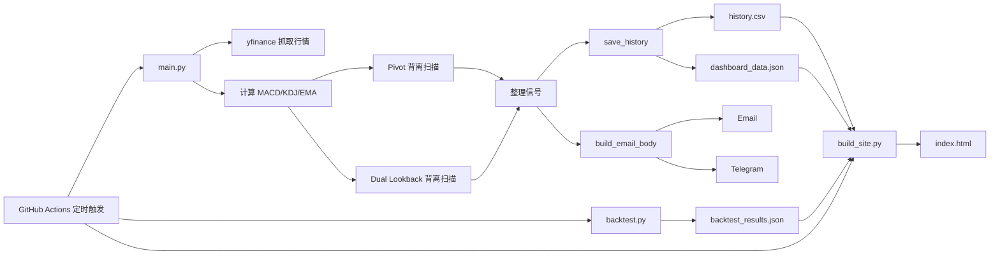

# Code Wiki

## 1. 项目概览

`sector-div-radar` 是一个以 Python 脚本为核心的量化监控仓库，围绕多资产背离信号扫描、历史回测验证、消息推送和静态 Dashboard 展示，形成了完整的自动化闭环：

`行情抓取 -> 指标计算 -> 背离识别 -> 历史落盘 -> 邮件/Telegram 推送 -> Dashboard 生成 -> GitHub Actions 定时运行`

项目当前没有复杂的面向对象分层，核心实现方式是“多个职责明确的脚本 + 共享数据文件 + 定时工作流”。

## 2. Wiki 导航

- [01-架构总览](./01-架构总览.md)
- [02-模块详解](./02-模块详解.md)
- [03-关键函数与符号](./03-关键函数与符号.md)
- [04-数据文件与依赖](./04-数据文件与依赖.md)
- [05-运行与运维](./05-运行与运维.md)

## 3. 仓库结构

```text
/workspace
├── .github/workflows/daily.yml     # 定时任务入口
├── main.py                         # 主扫描、消息编排、历史写入
├── backtest.py                     # 历史回测与胜率统计
├── build_site.py                   # 静态 Dashboard 生成
├── radar.py                        # 旧版行业雷达脚本
├── turnover.py                     # 换手率告警脚本
├── requirements.txt                # Python 依赖
├── history.csv                     # 历史信号库
├── dashboard_data.json             # Dashboard 快照数据
├── backtest_results.json           # 回测结果
└── index.html                      # 生成后的静态页面
```

## 4. 核心角色

- `main.py`
  - 项目的业务中枢。
  - 负责抓取行情、计算指标、识别背离、写入历史、生成邮件正文、发送 Email/Telegram、生成 Dashboard 数据快照。
- `backtest.py`
  - 项目的研究与评估层。
  - 负责用历史数据回放背离策略，输出各标的/周期/方向的统计结果。
- `build_site.py`
  - 项目的展示层构建器。
  - 负责把历史信号、回测结果和实时快照组装成 `index.html`。
- `.github/workflows/daily.yml`
  - 项目的自动化调度器。
  - 负责定时执行主扫描、条件回测、Dashboard 构建与结果提交。

## 5. 系统流程图



## 6. 技术摘要

- 语言：Python 3.11
- 核心库：`yfinance`、`pandas`、`numpy`、`scipy`、`requests`
- 外部服务：Gmail SMTP、Telegram Bot API、Financial Modeling Prep API、CallMeBot WhatsApp
- 输出形式：
  - 文本通知：Email、Telegram、WhatsApp
  - 数据产物：CSV、JSON
  - 展示产物：静态 HTML

## 7. 阅读建议

- 想快速理解项目：先看 [01-架构总览](./01-架构总览.md)
- 想看每个文件做什么：看 [02-模块详解](./02-模块详解.md)
- 想定位算法入口：看 [03-关键函数与符号](./03-关键函数与符号.md)
- 想接手部署或排障：看 [05-运行与运维](./05-运行与运维.md)
